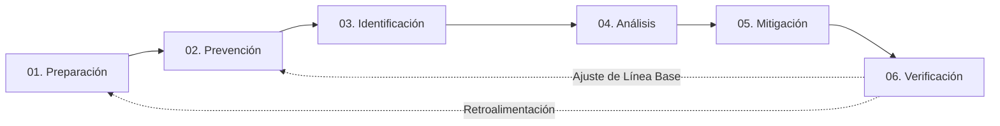
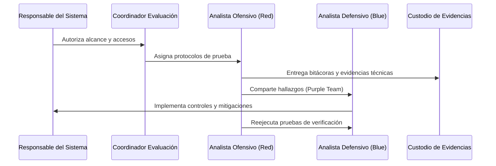

# Parte I y II: Fundamentación y Diseño Metodológico

## 1. Introducción y Propósito
El presente framework proporciona una ruta estructurada para planificar evaluaciones de seguridad autorizadas, identificar debilidades técnicas o humanas, analizar riesgos bajo criterios reproducibles y verificar la efectividad de las mitigaciones implementadas.

## 2. Referentes Técnicos y Normativos
| Referente | Aplicación en el Framework |
| :--- | :--- |
| **NIST CSF 2.0** | Organización de funciones de gobernanza y gestión de riesgos. |
| **NIST SP 800-115** | Guía técnica para ejecución de pruebas y evaluaciones de seguridad. |
| **MITRE ATT&CK** | Taxonomía de tácticas, técnicas y procedimientos (TTPs) adversarios. |
| **OWASP Top 10 / WSTG** | Estándar de pruebas y riesgos en aplicaciones web y APIs. |
| **ISO/IEC 27001 y 27005** | Contexto de gestión de seguridad de la información y tratamiento de riesgos. |

## 3. Arquitectura Metodológica Iterativa
El ciclo de evaluación opera de manera iterativa, donde los hallazgos verificados retroalimentan la preparación y los controles preventivos:

## 4. Actores y Responsabilidades (Enfoque Purple Team)

